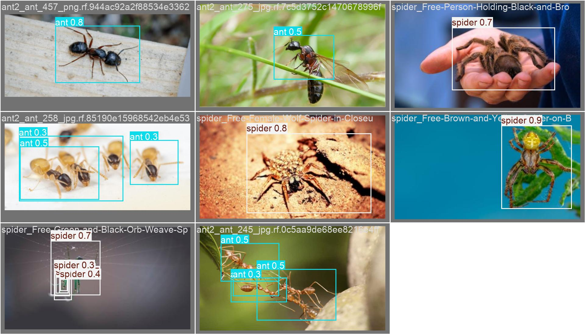
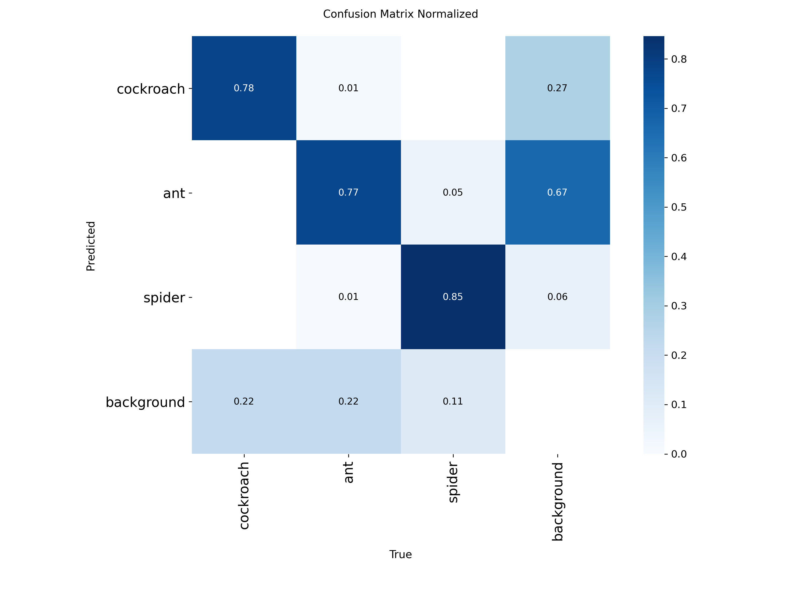
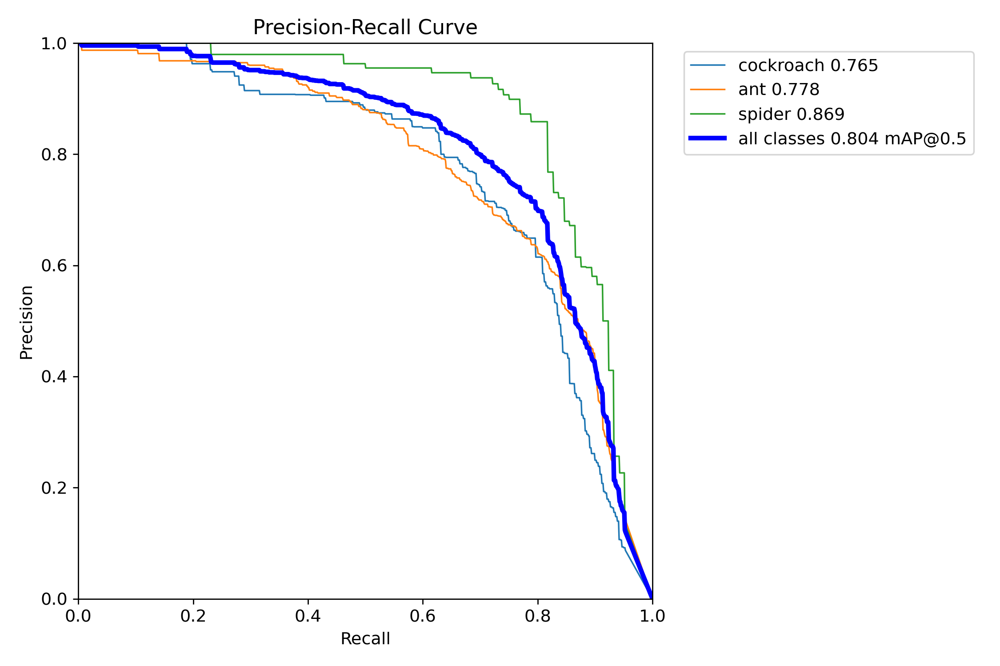
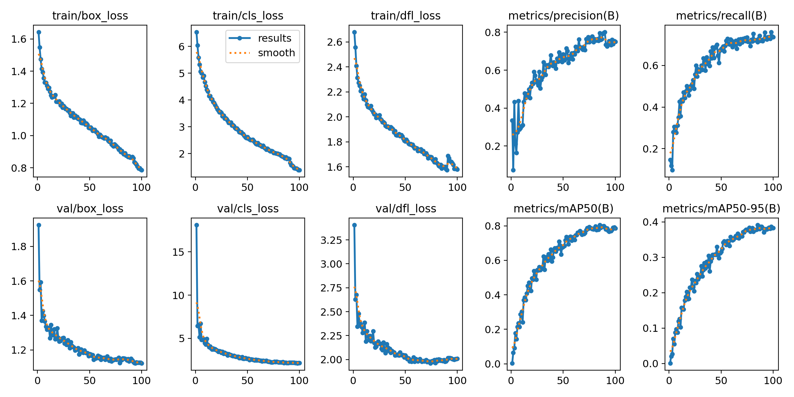

# Pest Detection — YOLOv8x 3-Class Detector

바퀴벌레 · 개미 · 거미 3종 해충을 탐지하는 객체 탐지 모델과 FastAPI 추론 서버입니다.
데이터 증강이 아닌 **데이터 수집 전략과 클래스 불균형 보정**으로 mAP@50을 59.4% → **80.4%** 까지 끌어올린 과정을 담았습니다.



---

## 핵심 성과

| 지표 | V1 (초기) | V3 (최종) | 개선 |
|---|---:|---:|---:|
| mAP@50 | 59.4% | **80.4%** | +21.0%p |
| mAP@50-95 | 28.4% | **39.0%** | +10.6%p |
| Precision | 57.7% | **79.5%** | +21.8%p |
| Recall | 62.9% | **71.2%** | +8.3%p |
| 개미 mAP@50 | 37.2% | **77.9%** | +40.7%p |

가장 취약했던 개미 클래스를 학습 데이터 14.5배 확충으로 정면 돌파한 것이 전체 성능을 끌어올린 결정적 요인이었습니다.

---

## 모델 성능 (실측)

`models/best.pt` 기준, validation 559장 / 1,185 인스턴스에서 직접 측정한 값입니다.

| 클래스 | 인스턴스 | Precision | Recall | mAP@50 | mAP@50-95 |
|---|---:|---:|---:|---:|---:|
| cockroach | 339 | 0.782 | 0.666 | 0.765 | 0.370 |
| ant | 742 | 0.765 | 0.652 | 0.778 | 0.415 |
| spider | 104 | 0.839 | 0.817 | **0.869** | 0.385 |
| **전체** | **1,185** | **0.795** | **0.712** | **0.804** | **0.390** |

추론 속도: **52.6 ms/image** (RTX 4060 Laptop, 640px, batch 8)

<table>
<tr>
<td></td>
<td></td>
</tr>
<tr>
<td align="center">Confusion Matrix (normalized)</td>
<td align="center">Precision-Recall Curve</td>
</tr>
</table>



---

## 개선 과정

### V1 — 문제 정의
초기 모델(mAP@50 59.4%)의 결과 파일을 분석해 병목을 특정했습니다.

- **개미 mAP@50 37.2%** — 학습 이미지가 87장뿐이라 특징을 학습하지 못함
- **배경 오탐 221건** — 해충이 없는 영역을 해충으로 판단
- **mAP@50-95 28.4%** — IoU 50%는 통과하지만 박스 위치가 부정확
- Epoch 64 이후 validation loss가 `nan` 으로 발산

### V2 — 데이터 4.7배 + 하이퍼파라미터 조정
개미 데이터를 87장 → 405장으로 늘리고, 과도한 증강을 완화했습니다.

```
mosaic  1.0 → 0.7      # 원본 패턴 보존
erasing 0.4 → 0.2
box     7.5 → 5.0      # loss weight 재조정
cls     0.5 → 1.0      # 클래스 분류 강화
batch   4   → 8
```

결과는 절반의 성공이었습니다. mAP@50은 68.5%로 올랐지만 **개미 False Positive가 82 → 234건(+185%)으로 폭증**했습니다. 데이터를 늘려 민감도만 높아진 것으로, 데이터 증가에는 추론 임계값 재조정이 함께 따라와야 한다는 점을 확인했습니다.

### V3 — 데이터 14.5배 + 클래스별 임계값
개미 데이터를 최종 1,262장까지 확충했습니다(V1 대비 14.5배).

| | V1 | V2 | V3 |
|---|---:|---:|---:|
| 개미 학습 이미지 | 87 | 405 | **1,262** |
| 개미 mAP@50 | 37.2% | 51.8% | **77.9%** |
| 개미 Recall | 52.3% | 40.4% | **65.5%** |
| 전체 False Positive | 221 | 362 | **246** |

동시에 V2에서 드러난 오탐 문제를 서빙 단에서 보정했습니다. 클래스마다 데이터 양이 다르므로 단일 임계값 대신 **클래스별 confidence threshold**를 적용합니다 (`main.py`).

```python
CLASS_CONF_THRESHOLDS = {
    0: 0.45,  # cockroach — 데이터 충분, FP 억제 우선
    1: 0.35,  # ant
    2: 0.30,  # spider — 데이터 부족, recall 확보 우선
}
```

### 학습 중 문제 해결
데이터셋 규모가 4,600여 장으로 커지면서 `MemoryError`가 발생했습니다. RTX 4060 8GB 환경에서 `workers 8 → 4`, `batch 8 → 4`로 낮춰 resume에 성공했고, 100 epoch를 완주했습니다.

---

## 학습 구성

| 항목 | 값 |
|---|---|
| 아키텍처 | YOLOv8x (68M params, 257.4 GFLOPs) |
| 사전학습 | COCO pretrained (`yolov8x.pt`) |
| 입력 크기 | 640 × 640 |
| Optimizer | AdamW |
| Epochs | 100 (best: epoch 85) |
| Batch / Workers | 4 / 4 |
| Patience | 50 |
| GPU | RTX 4060 Laptop (8GB) |
| 학습 시간 | 약 7시간 |

## 데이터셋

| Split | 이미지 | cockroach | ant | spider |
|---|---:|---:|---:|---:|
| train | 3,823 | 2,464 | 3,532 | 574 |
| valid | 559 | 339 | 742 | 104 |

클래스별 숫자는 라벨링된 **인스턴스 수**입니다. 학습에 쓴 이미지 원본은 용량 문제로 저장소에 포함하지 않았고, 저장소의 `dataset/` 에는 `data.yaml` 과 테스트 이미지만 있습니다.

Roboflow 공개 데이터셋(`marks-workspace-ciafp/pest-detection-4class`, CC BY 4.0)을 기반으로, 개미 데이터셋 4종을 추가 수집해 병합했습니다. 병합·리매핑·빈 라벨 정리 스크립트는 `scripts/` 에 있습니다.

> 거미는 학습 인스턴스가 574개로 가장 적지만 형태 구분이 뚜렷해 가장 높은 mAP(86.9%)를 기록했습니다. 반대로 개미는 데이터가 가장 많음에도 크기가 작아 recall이 낮습니다.

---

## 실행 방법

### 로컬

```bash
python -m venv venv
source venv/bin/activate        # Windows: venv\Scripts\activate
pip install -r requirements.txt

uvicorn main:app --reload
```

`http://localhost:8000/docs` 에서 Swagger UI로 바로 테스트할 수 있습니다.

### Docker

```bash
docker build -t pest-detection-api .
docker run -p 8000:8000 pest-detection-api
```

### 모델 파일

`models/best.pt` (137MB)는 Git LFS로 관리됩니다. 클론 전에 [Git LFS](https://git-lfs.github.com/)가 설치되어 있어야 합니다.

```bash
git lfs install
git clone https://github.com/lee-mark01/ai-model.git
```

---

## API

| 메서드 | 경로 | 설명 |
|---|---|---|
| `GET` | `/` | 모델 정보 및 클래스 목록 |
| `GET` | `/health` | 헬스 체크 |
| `POST` | `/predict` | 탐지 결과 JSON + 바운딩 박스 이미지(base64) |
| `POST` | `/predict/json` | 탐지 결과 JSON만 (이미지 인코딩 생략, 응답 빠름) |

```bash
curl -X POST "http://localhost:8000/predict/json" -F "file=@image.jpg"
```

```json
{
  "success": true,
  "count": 1,
  "detections": [
    {
      "box": { "x1": 123.45, "y1": 67.89, "x2": 234.56, "y2": 178.90 },
      "class_id": 0,
      "class_name": "cockroach",
      "confidence": 0.854
    }
  ]
}
```

상세 연동 가이드는 [README_API.md](README_API.md) 를 참고하세요.

---

## 프로젝트 구조

```
.
├── main.py                 # FastAPI 추론 서버
├── models/best.pt          # 최종 모델 (YOLOv8x, Git LFS)
├── Dockerfile
├── requirements.txt
├── dataset/                # 초기 Roboflow 데이터셋 (data.yaml + 테스트 이미지)
├── scripts/                # 학습 · 데이터 병합 · 평가 스크립트
├── docs/                   # 평가 그래프
└── results/                # 추론 결과 샘플
```

---

## 한계 및 개선 방향

- **Recall 71.2%** — 실제 해충 10마리 중 3마리는 놓칩니다. 서비스 적용 시 미탐지 비용을 고려해 임계값 재조정이 필요합니다.
- **mAP@50-95 39.0%** — 박스 위치 정밀도가 낮은 편입니다. 고해상도 입력(1280px) 학습으로 개선 여지가 있습니다.
- **배경 오탐 246건** — V2(362건) 대비 32% 줄였지만 V1(221건)보다는 여전히 많고, 목표였던 -50%에도 미달했습니다. 해충이 없는 배경 이미지를 negative sample로 추가하는 방식을 검토 중입니다.
- **거미 데이터 부족** — 574 인스턴스로 바퀴벌레의 1/4, 개미의 1/6 수준입니다. 현재 성능은 높지만 일반화 여부는 추가 검증이 필요합니다.

## 라이선스

- **모델 가중치**: Ultralytics YOLOv8 기반이므로 **AGPL-3.0** 이 적용됩니다. 상업적 사용 시 소스 공개 의무 또는 Ultralytics Enterprise 라이선스가 필요합니다.
- **데이터셋**: CC BY 4.0 (Roboflow) — 재배포 시 출처 표기가 필요합니다.
